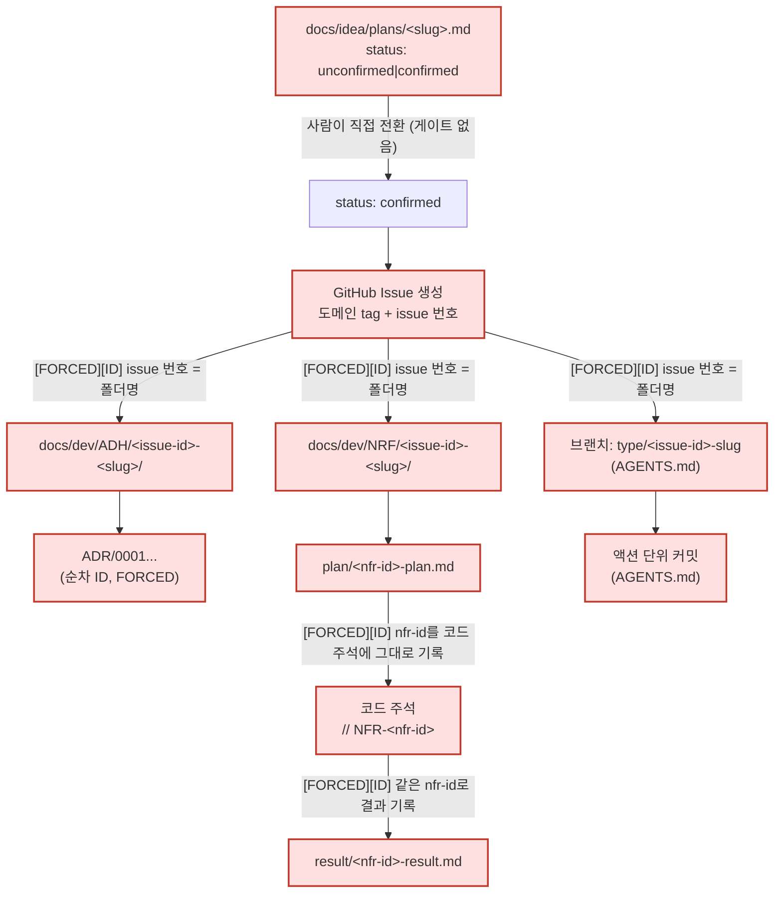
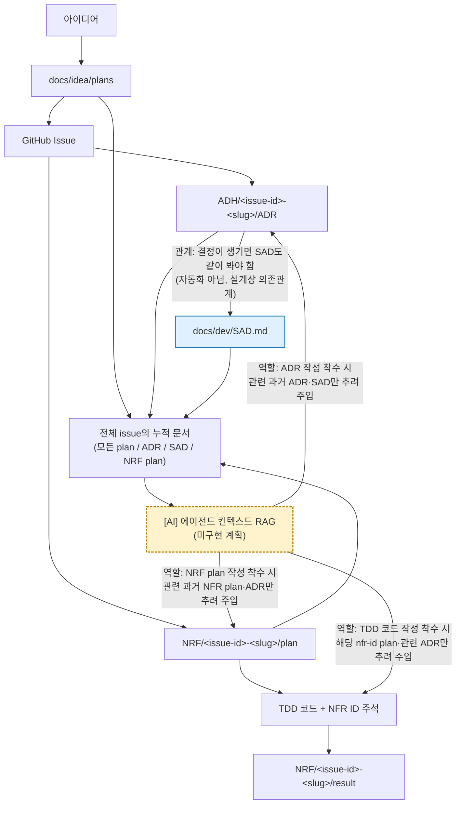
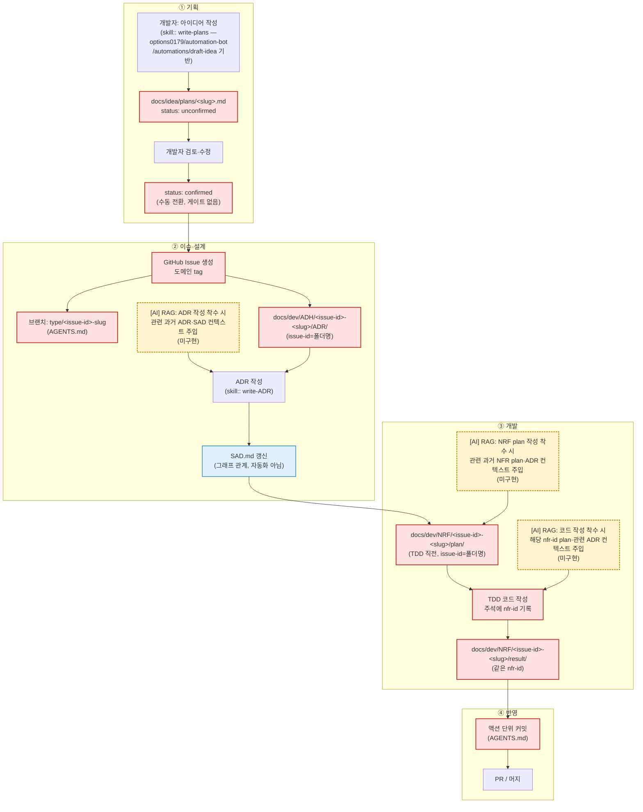

# docs/dev/ 운용 규칙

GitHub Issue가 생긴 이후 — 설계(ADR/SAD)부터 TDD 개발(NRF)까지의 파이프라인. `docs/idea/`에서 `status: confirmed`가 된 계획이 Issue가 되면 이 단계로 넘어온다.

## 용어

| 용어 | 의미 |
|---|---|
| SAD | System Architecture Document — 전체 아키텍처를 설명하는 단일 생존 문서. `SAD.md` |
| ADH | ADR을 담는 이슈별 컨테이너 폴더 |
| ADR | Architecture Decision Record — 결정 1건당 1 문서 |
| NRF | 이슈 기반 TDD 직전에 두는 비기능요구(NFR) 검증 폴더 |
| SRS / NFR | 코드 온보딩 주석이 참조하는 요구사항 ID의 출처 |
| graph engineering | 작업 단계 사이의 노드/엣지(의존관계·트리거)를 명시적으로 설계하는 것 |
| harness engineering | 각 단계 전환에 게이트(ID 강제, 커밋 규칙)를 걸어 이탈을 막는 것 |

## 폴더

```text
docs/dev/
├── README.md          # 이 문서
├── SAD.md             # 현행 구현의 시스템 구조 요약
├── frontend-backend-contract.md  # 프런트엔드 ↔ 백엔드 API 계약
├── env.md             # 환경변수와 로컬 실행 안내
├── agent/             # 코드가 런타임에 읽는 활성 Agent 지침·Skill
├── archive/           # 현행 기준이 아닌 과거 설계·마이그레이션 기록
│   ├── agent/          # 과거 Copilot/MCP/Gemini 전환 기록
│   ├── database-summary.md
│   └── firebase-chat-memory-schema.md
├── ADH/
│   └── TEMPLATE/ADR/TEMPLATE.md     # 실제 사용 시 TEMPLATE → <issue-id>-<slug>
└── NRF/
    └── TEMPLATE/{plan,result}/TEMPLATE.md

제품 요구와 제품 검증 가설은 `docs/product/`, 사용자 대면 Agent 원칙은 `docs/agent/`에서 관리한다. 저장소 문서의 전체 역할과 탐색 순서는 루트 [`PROJECT-DOCUMENTS.md`](../../PROJECT-DOCUMENTS.md)를 먼저 읽는다.
```

issue가 생기면 `ADH/TEMPLATE/`, `NRF/TEMPLATE/`를 `<issue-id>-<slug>/`로 복사해서 쓴다. `TEMPLATE`라는 이름 그대로는 실제 작업에 쓰지 않는다.

## A. Harness Engineering 구조 — 강제(FORCED) / ID 연결



`[FORCED]` = 사용자가 강제한 규칙. 전부 "ID 문자열이 폴더명/파일명/주석에 그대로 반복"되는 형태이며, 자동 검증 스크립트는 없다 — 리뷰에서 사람이 이름 일치를 확인한다.

## B. Graph Engineering 구조 — 관계 + [AI] 계획



`[AI]`는 사용자가 명시하지 않았지만 세션 대화 맥락에서 보충한, 아직 구현되지 않은 계획이다. RAG는 "문서 인덱싱"이 아니라 **ADR·NRF plan·코드 작성 착수 시점**에만 존재하며, 역할은 그 시점에 관련된 과거 문서만 추려 컨텍스트로 주입하는 것이다.

## C. 통합 E2E 개발자 시나리오



빨강(forced/ID) = 강제 규칙, 파랑(graphRel) = 자동화 없는 문서 의존관계, 노랑 점선([AI]) = 미구현 계획.

## 지금 빠진 것 (의도적으로 미구현)

- Discord 멘션 자동화, 체크리스트 자동 게이트 — 제거됨, 수동 전환만 있음
- `skill:: write-plans`, `skill:: write-ADR` — 아직 호출 가능한 skill이 아니라 "이렇게 동작해야 한다"는 설계 메모
- `[AI] 에이전트 컨텍스트 RAG` — 미구현
- 문서-코드 ID 불일치에 대한 자동 검증 — 없음, 리뷰에서 사람이 확인 (`AGENTS.md` 문서-코드 강제 ID 규칙 참조)
