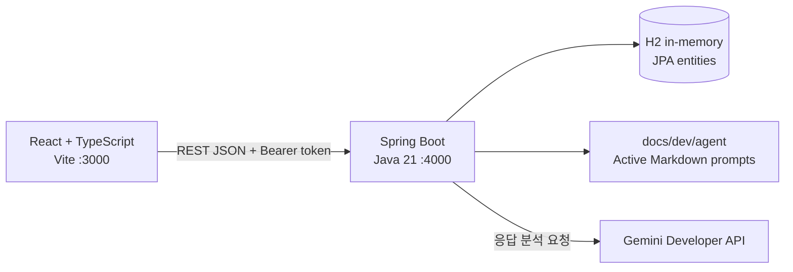

# RE:DAY 시스템 아키텍처

> 이 문서는 현재 체크아웃의 Java/Spring Boot + React/Vite 구현을 기준으로 역문서화한다. 과거 Node/Next.js, Firebase/Firestore, Copilot Studio 및 MCP 설계는 현재 런타임 설명이 아니다. 제품 요구, 제품 가설, Agent 행동 원칙은 각각 [`../product/requirements.md`](../product/requirements.md), [`../product/discovery.md`](../product/discovery.md), [`../agent/behavior.md`](../agent/behavior.md)에서 관리하며 이 문서에는 구현된 구조만 기록한다.

## 목적과 범위

RE:DAY는 사용자가 직무 상황을 체험하고 선택의 결과를 확인하는 웹 서비스다. 이 문서는 현재 코드에 구현된 구성, 요청 경계, 데이터 상태만 설명한다. 사용자 문제·기능 우선순위·검증 가설은 제품 문서에, Agent의 사용자 대면 행동 원칙은 Agent 행동 명세에 둔다. 배포 인프라나 아직 연결되지 않은 외부 서비스는 구현된 것처럼 다루지 않는다.

## 런타임 구성



### 프런트엔드

- Vite가 React 18 / TypeScript 앱을 개발 모드로 제공합니다.
- `frontend/src/App.tsx`가 라우트를 구성하고 로그인 이후 화면을 `ProtectedRoute`로 감쌉니다.
- `frontend/src/routes/`는 화면별 페이지를, `components/`는 공통 화면 요소를 둡니다.
- `frontend/src/lib/api.ts`가 `VITE_API_BASE_URL`을 기준으로 JSON 요청을 보내고 저장된 토큰을 `Authorization: Bearer` 헤더에 붙입니다.
- `frontend/src/lib/auth.tsx`는 사용자 상태를 React Context로 제공하고 토큰과 사용자 표시 정보를 `localStorage`에 보관합니다.

### 백엔드

- `ReDayApplication`이 Spring Boot 앱을 시작합니다. 로컬에서는 `backend/.env`, 다음으로 저장소 루트 `.env` 값을 읽되 이미 설정된 프로세스 환경변수는 덮어쓰지 않습니다.
- `WebConfig`가 CORS, 인증 인터셉터, `@CurrentUserId` 인자 해석기를 등록합니다.
- Controller는 HTTP 입출력을 받고, Service는 도메인 동작과 트랜잭션을 수행합니다. JPA Repository가 H2 데이터를 읽고 씁니다.
- `GlobalExceptionHandler`가 도메인 오류와 검증 오류를 공통 JSON 오류 응답으로 변환합니다.

| 패키지 | 역할 |
|---|---|
| `auth` | 사용자 가입·로그인, 개발용 이메일 인증 토큰, bearer 토큰 해석 |
| `jobs` | 직무·variant 조회, 시작 시 샘플 카탈로그 저장 |
| `sessions` | 체험 진행, 단계 기록, 재도전 분기, 요약 및 상태 조회 |
| `home`, `history` | 세션 데이터를 홈 및 기록 화면에 맞는 조회 모델로 제공 |
| `ai` | 프롬프트/Skill 로드, Gemini API 호출, 분석·결과 파싱 |
| `common` | CORS, 현재 사용자 주입, 오류 응답, health endpoint |

## 사용자 흐름과 API

| 화면 | API | 구현 책임 |
|---|---|---|
| 가입·로그인 | `POST /auth/signup`, `/auth/verify-email`, `/auth/login`, `/auth/consent` | 비밀번호 해시, 개발 인증 토큰, 로그인 토큰 |
| 홈 | `GET /home/summary` | 진행 중 세션 1개와 완료 기록 최대 3개 |
| 직무 선택 | `GET /jobs`, `/jobs/popular`, `/jobs/{jobId}/variants` | 로컬 직무 카탈로그 및 상황 묶음 조회 |
| 체험 시작/복원 | `POST /sessions`, `GET /sessions/{id}`, `GET /sessions/{id}/steps` | 세션 생성, 현재 상황·전체 단계 반환 |
| 초안 | `PATCH /sessions/{id}/draft` | 현재 세션 응답 초안 갱신 |
| 상황 제출 | `POST /sessions/{id}/steps` | 소유권·버전 확인 → Gemini 분석 → 단계 기록·진행 갱신 |
| 재시도 | `POST /sessions/{id}/steps/{stepIndex}/retry` | 같은 제출 경로를 호출하는 편의 엔드포인트 |
| 되돌아가기 | `POST /sessions/{id}/rollback` | 원 세션을 보존하고 앞 단계가 복사된 새 분기 생성 |
| 완료·회고 | `POST /sessions/{id}/complete`, `GET/PUT /sessions/{id}/summary` | 단계 기반 요약 생성, 사용자 회고 읽기·저장 |
| 기록 | `GET /history?filter=all\|byJob\|recent` | 완료 세션 조회 |

`SessionController`는 경로를 `SessionService`로 위임합니다. 홈과 기록은 공통 `SessionQueryService`를 사용하므로 같은 세션 테이블의 서로 다른 projection입니다.

## 핵심 데이터

```text
User ──< AuthToken
  └──< ExperienceSession ──< ExperienceStep
           ├── parentSessionId (선택: rollback 분기 원본)
           └── ExperienceSummary (선택: 완료 후 1개)

JobCatalogEntry ──< JobVariant ── situationTemplates[]
ExperienceSession.jobId / variantId ── 직무 선택을 참조
```

- `JobCatalogEntry`, `JobVariant`: fixture에서 초기 적재되는 직무, 상황 제목·서술·시간 압박, 하루 timeline.
- `ExperienceSession`: 소유자, 직무/variant, 상태, 현재 단계, 생성 시 확정한 `totalSteps`, `stateVersion`, 임시 답변, 부모 분기 정보를 저장합니다.
- `ExperienceStep`: 제출 답변, 당시 상황 복사본, 분석과 결과를 저장합니다. 서비스 흐름에서는 기존 단계를 갱신하지 않고 새로 기록하며, 같은 세션의 같은 단계 인덱스에 unique 제약이 있습니다.
- `ExperienceSummary`: 완료 시 만들어지는 타임라인 요약, 강점, 다음 시도, 행동 태그, 사용자 회고를 저장합니다.
- 저장소는 H2 인메모리이며 배포용 영속 데이터베이스는 현재 설정되어 있지 않습니다.

## 세션 상태와 동시성

1. `POST /sessions`는 직무와 variant가 서로 연결되는지 확인합니다. `totalSteps`는 variant의 상황 수로 설정하고 세션 상태를 `BRIEFING`, 버전을 `1`로 시작합니다.
2. 제출 요청은 소유자, `expectedStateVersion`, `stepIndex`, 남은 상황 수를 확인합니다. 버전이 다르면 `409`와 최신 버전/최근 단계 정보를 돌려줍니다. 이는 서비스 계층의 stale-write 검사이며 JPA `@Version`이나 DB compare-and-set 잠금은 아닙니다.
3. Gemini가 분석과 결과를 반환하면 `ExperienceStep`을 추가하고 현재 인덱스와 버전을 각각 1 증가시킵니다. 초안을 비우고 상태를 `IN_PROGRESS`로 바꿉니다. 모델 응답을 기다리는 동안 제출 트랜잭션이 열려 있습니다.
4. 마지막 단계까지 응답한 뒤 완료 요청이 오면 기존 요약이 있는지 확인하고, 없으면 저장된 단계에서 회고용 요약을 규칙 기반으로 만듭니다. 세션은 `COMPLETED`가 됩니다.
5. rollback은 원 세션이나 단계를 수정·삭제하지 않습니다. `toStepIndex` 이전 단계들을 새 세션으로 복사하고, 그 인덱스부터 다시 진행할 분기 세션을 반환합니다.

## AI 분석 경로

```text
SessionService.submitStep
  → SceneAnalysisService.analyze(job, situation, response)
  → AgentPromptCatalog.load(docs/dev/agent)
  → main-instructions + responseanalyzer + consequencesimulator
  → GeminiClient.generate(JSON schema constrained)
  → analysis / consequence 파싱
  → ExperienceStep 저장
```

프롬프트 디렉터리는 `REDAY_AGENT_DOCS_DIR`로 설정하며 기본값은 `../docs/dev/agent`입니다. 모델과 키는 `GEMINI_MODEL`, `GEMINI_API_KEY`(또는 기존 입력 이름 `gemini_api_key`)로 설정합니다. 호출은 Gemini Developer API를 직접 사용하며 Firebase, Copilot Studio, 별도 MCP 서버를 경유하지 않습니다.

## 인증과 요청 보호

- `AuthInterceptor`는 `Authorization: Bearer <token>`을 토큰 저장소에서 조회해 사용자 ID를 요청 속성에 붙입니다.
- Handler parameter에 `@CurrentUserId`가 있으면 `CurrentUserArgumentResolver`가 인증된 ID를 요구합니다. ID가 없으면 `401`입니다.
- 세션 읽기/쓰기 서비스는 `requireOwned`로 세션 존재 여부와 소유자를 확인합니다. 다른 사용자의 세션은 없는 세션처럼 `404`를 반환합니다.
- 직무 조회와 health endpoint는 `@CurrentUserId`를 요구하지 않습니다.
- CORS 기본 허용 origin은 `http://localhost:3000`이며 `CORS_ORIGIN`으로 바꿀 수 있습니다.
- 로그인 토큰에는 현재 만료 시각/회수 endpoint가 구현되어 있지 않습니다. 인증과 데이터 저장소는 MVP 수준입니다.

이 토큰은 현재 앱의 DB에 저장되는 UUID 기반 토큰입니다. Firebase Auth, 운영 메일 발송, 외부 identity provider가 연결되어 있지 않습니다.

## 설정과 로컬 실행

| 설정 | 기본값 | 설명 |
|---|---|---|
| `PORT` | `4000` | Spring Boot HTTP 포트 |
| `CORS_ORIGIN` | `http://localhost:3000` | 허용할 프런트엔드 origin |
| `GEMINI_API_KEY` | 비어 있음 | Gemini 키, AI 분석 요청에 필요 |
| `GEMINI_MODEL` | `gemini-flash-latest` | Gemini 모델 |
| `REDAY_AGENT_DOCS_DIR` | `../docs/dev/agent` | Agent 지침 디렉터리(backend 기준 상대 경로) |
| `VITE_API_BASE_URL` | `http://localhost:4000` | 프런트엔드 API base URL |

```bash
# Terminal 1
cd backend && mvn spring-boot:run

# Terminal 2
cd frontend && npm install && npm run dev
```

## 문서 경계와 과거 설계

- README·코드·이 문서는 현재 `backend/` Java 소스 및 `frontend/` React 소스를 기준으로 합니다.
- `docs/dev/agent/`에는 현재 코드가 실제로 읽는 `main-instructions.md`와 `skills/*.md`만 둡니다. 코드 실행이 Agent 행동 명세 문서를 직접 읽는다는 뜻은 아닙니다.
- 제품 요구·발견 가설·Agent 행동 명세는 구현 여부를 설명하지 않습니다. 구현 상태와 아키텍처의 기준은 현재 코드와 이 SAD입니다.
- `docs/dev/archive/`는 과거 설계·마이그레이션 기록을 보존합니다. 그 안의 Firebase/Firestore, Next.js, Node/Express, Copilot Studio 및 MCP 설명은 현행 런타임으로 해석하지 마세요.
- 현재 backend의 테스트는 `backend/src/test/`에 있습니다. 프런트엔드에는 별도 test script가 정의되어 있지 않습니다.
